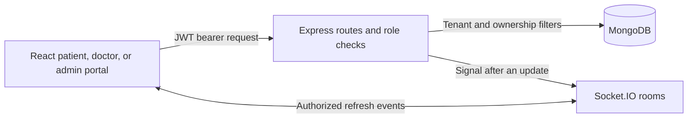
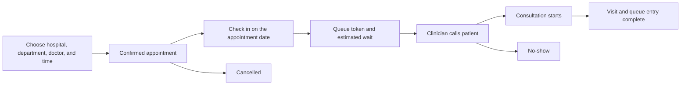
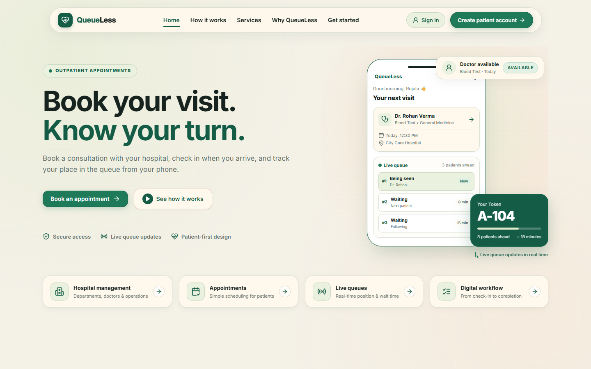
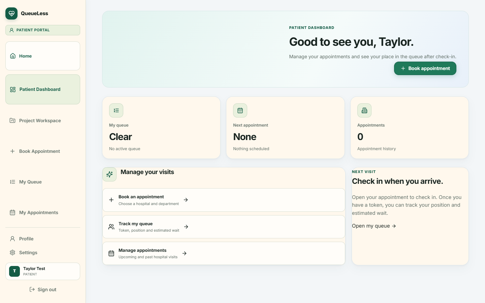
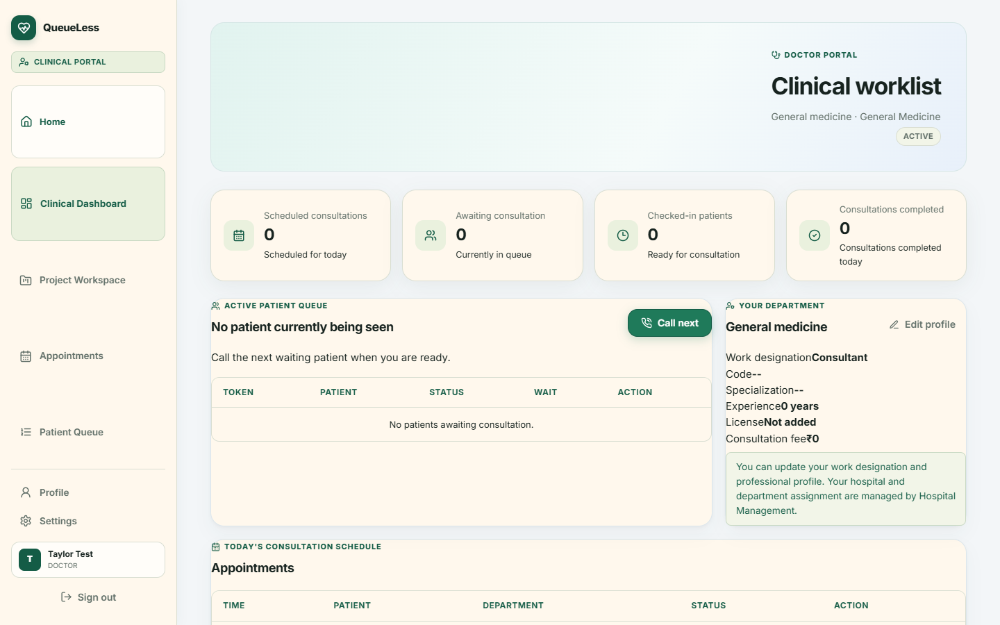
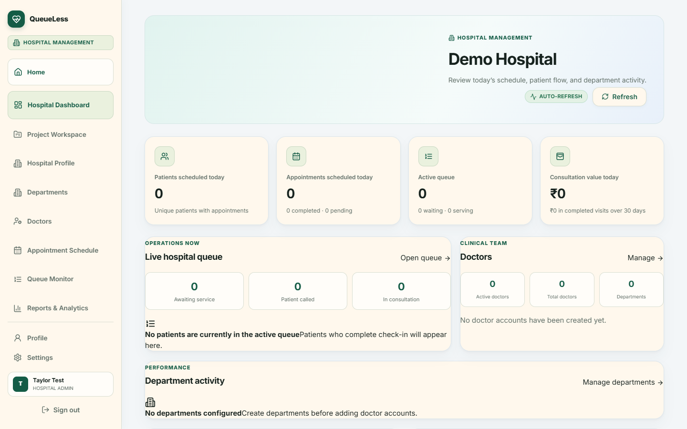

# QueueLess

QueueLess is a multi-tenant outpatient scheduling and queue management application. Patients can choose a consultation, check in on the day of their visit, and follow their place in the queue. Clinicians and hospital teams can coordinate the schedule and manage patient flow from role-specific dashboards.

## Problem

Appointment books record when visits are expected. They rarely tell patients or staff what is happening after arrival. QueueLess connects booking, check-in, consultation, and reporting so staff can manage active visits and patients can see an estimated wait.

## Features and roles

| Role | Capabilities |
| --- | --- |
| Patient | Browse active hospitals and doctors, book an available consultation, check in, track a queue token and estimated wait, and review appointment history |
| Doctor | Review the assigned worklist, call the next patient, start and complete consultations, and mark no-shows |
| Hospital admin | Set up the hospital, departments, and doctor accounts, monitor appointments and queues, and review hospital activity reports |
| Staff | Use the hospital schedule and queue operations for an assigned hospital. The role remains supported for older accounts. |

The project workspace supports shared tasks, project membership, and task version checks.

## Architecture

The client uses React 19, React Router, Vite, Axios, Lucide, GSAP, and Socket.IO Client. The API uses Node.js, Express 5, MongoDB, Mongoose 9, Socket.IO 4, JWT, and bcrypt.



Hospitals are represented by the `Business` model. Appointments and queue entries carry the hospital identifier alongside the patient, service, and, where applicable, the department and doctor. Department records keep a reference to the legacy service used for booking and duration calculations. Patients may book at different hospitals and see records linked to their own account. Hospital teams are scoped to their assigned hospital. Doctor worklists are scoped to the assigned clinician. Project access requires ownership or membership in the same workspace tenant.

Socket.IO validates the session token and authorizes each requested room. Clinical events tell the client to refresh through REST. Their payload contains the hospital identifier. Clients periodically refresh as a fallback when the socket is unavailable.



Wait predictions combine queue order, historical consultation durations, and the service duration and buffer settings. The result is an estimate that changes as the queue moves.

## Project structure

```text
Client/
  src/components/   Route guards and shared UI
  src/context/      Authentication state
  src/layouts/      Portal navigation
  src/pages/        Public pages, dashboards, and workflows
  src/services/     HTTP and Socket.IO clients
Server/
  src/controllers/  Workflow handlers
  src/middleware/   Session and role checks
  src/models/       MongoDB schemas and indexes
  src/routes/       Express route definitions
  src/services/     Queue, appointment, realtime, and analytics logic
  src/tests/        Database and API workflow tests
assets/             Project screenshots
```

## API overview

All paths are relative to `/api`. Protected routes accept `Authorization: Bearer <token>`.

| Area | Endpoints |
| --- | --- |
| Session | `POST /auth/register`, `POST /auth/login`, `GET /auth/me` |
| Directory and availability | `GET /businesses`, `GET /businesses/:id/departments`, `GET /doctors/public?departmentId=…`, `GET /doctors/availability?doctorId=…&date=YYYY-MM-DD` |
| Appointments | `POST /appointments`, `GET /appointments/my`, `GET /appointments/:id`, `PATCH /appointments/:id/check-in`, `PATCH /appointments/:id/cancel` |
| Queue and wait | `GET /queue/my`, `GET /queue/business/:businessId`, `GET /predictions/wait-time`, `/staff/queue` |
| Dashboards and setup | `GET /doctor/dashboard`, `GET /business/dashboard`, `/admin/business`, `/admin/departments`, `/admin/doctors`, `/analytics` |
| Workspace | `/projects`, `/tasks` |
| Health | `GET /health` |

## Local setup

Use Node.js 22 or newer and MongoDB 6.0 or newer. Install both packages from the repository root.

```sh
npm ci --prefix Server
npm ci --prefix Client
```

Copy `Server/.env.example` to `Server/.env` and `Client/.env.example` to `Client/.env`. Set a unique JWT secret and start MongoDB. Run each command in its own terminal.

```sh
npm run dev --prefix Server
npm run dev --prefix Client
```

Open [the local client](http://localhost:5173). Confirm database connectivity at [the API health endpoint](http://localhost:5000/api/health).

Public registration creates a patient account. To provision the first local hospital administrator, register a development account and set its `role` to `ADMIN` in your local MongoDB `users` collection. Sign in again, complete Hospital Profile, create a department, and create a doctor account from the Doctors screen. Use synthetic names and appointment notes for demo data.

### Environment variables

| File | Variable | Purpose |
| --- | --- | --- |
| `Server/.env` | `PORT` | API and Socket.IO port, defaults to `5000` |
| `Server/.env` | `CLIENT_URL` | Allowed browser origin, defaults to `http://localhost:5173` |
| `Server/.env` | `MONGO_URI` | MongoDB connection URI |
| `Server/.env` | `MONGO_DB_NAME` | Optional database name override |
| `Server/.env` | `JWT_SECRET` | Secret for verifying session tokens |
| Server process | `TZ` | Hospital calendar timezone for the deployment, for example `Asia/Kolkata` |
| `Client/.env` | `VITE_API_URL` | API base URL including `/api` |
| `Client/.env` | `VITE_SOCKET_URL` | Socket.IO origin. Defaults to the API origin. |

The doctor-slot index enforces one occupied appointment per hospital, doctor, date, and time. If an existing database contains exact duplicate occupied slots, reconcile those records before starting the upgraded API so MongoDB can build the index.

## Verification

Run the backend suites against an isolated development database configured through `MONGO_URI`. Install both packages first because the API workflow suite uses the client’s Socket.IO package.

```sh
npm test --prefix Server
npm run test:workspace --prefix Server
npm run test:api --prefix Server
npm run build --prefix Client
```

The API workflow exercises authenticated and cross-tenant requests, Socket.IO room access and event payloads, hospital setup, availability, concurrent booking and check-in, wait prediction, and consultation completion.

The mobile Chrome smoke test used the live local API for registration, booking, check-in, and a Socket.IO-driven queue update. The landing page, booking form, and three role dashboards were also checked in Chrome at 390, 768, and 1440 pixels using synthetic data. Production hosting and cross-browser coverage remain unverified.

## Screenshots

The dashboard screenshots use synthetic demo data.









## Future improvements

- Per-hospital timezones, configurable doctor hours, and time-off calendars.
- Appointment reminders and rescheduling with patient notification preferences.
- Audit trails for clinical record access and status changes.
- Transactional queue updates and a shared Socket.IO adapter for multi-instance deployments.
- Browser regression tests for booking, check-in, and role-specific workflows.
