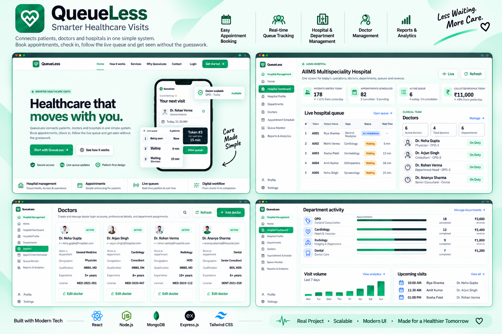

# QueueLess | Multi-Tenant Healthcare SaaS & Collaborative Workspace

<p align="center">
  
</p>

<p align="center">
  
  
  
  
  
</p>

---

## 🌿 Executive Summary

**QueueLess** is an enterprise-grade multi-tenant healthcare appointment booking, live queue orchestration, and collaborative project management platform. Designed specifically for hospitals, multi-specialty clinics, and outpatient care centers, QueueLess eliminates waiting room ambiguity by syncing patients, doctors, and healthcare administrators into a calm, unified, real-time digital workflow.

In addition to end-to-end outpatient workflow management, QueueLess incorporates an integrated **Collaborative Project Workspace (ALG-WEB-01)** enabling healthcare operations teams to coordinate initiatives, track clinical projects, manage tasks via Kanban and list views, and safely resolve simultaneous updates using robust **Optimistic Concurrency Control (Version Locking)**.

---

## 🎨 Visual Identity & Master Design System

QueueLess embodies a soothing, patient-first aesthetic that departs from cold clinical interfaces and neon gradients:

- **Soft Pistachio Green (`#DCE8C8` / `#EAF1DE`)**: Evokes calm, healing, and clarity.
- **Warm Cream (`#FFF8ED` / `#F4F1E7`)**: Organic warmth replacing harsh pure white `#FFFFFF`.
- **Subtle Peach Accents (`#F7E1CF` / `#FBEDE1`)**: Gentle human warmth on status badges and cards.
- **Deep Forest Green (`#145C46` / `#1F7A5A`)**: Authoritative branding, primary buttons, and tokens.
- **Dark Charcoal (`#17231F`)**: High-contrast, highly readable typography.
- **Scrolling Enhancements**: Smooth scroll behavior (`html { scroll-behavior: smooth }`), dynamic floating navbar elevation on scroll (`.public-nav.scrolled`), intersection-observer scroll reveals (`.reveal-on-scroll.is-visible`), organic drift animations (`@keyframes floatSlow`), sticky data table headers, and a floating Back-to-Top trigger.

---

## 🌟 Core System Pillars

### 1. Patient Portal
- **Instant Booking**: Browse hospital departments, select verified doctors, choose convenient dates and real-time available time slots.
- **Live Queue & Token Tracker**: Receive an automated sequential queue token upon check-in, tracking estimated wait times, remaining patients ahead, and real-time status transitions (`WAITING` ➔ `CALLED` ➔ `SERVING` ➔ `COMPLETED`).
- **Comprehensive Visit Details**: Access consultation fees, clinic address with interactive icons, appointment timelines, and clinical notes/prescriptions.

### 2. Clinical Portal (Doctor Dashboard)
- **Real-Time Patient Queue**: View checked-in patients in order of arrival, call next in queue, initiate consultations, and complete visits.
- **Clinical Records**: Document diagnosis, consultation notes, and patient advice directly into the permanent electronic visit log.
- **Appointment Schedule**: Overview of daily bookings, status filtering (`CONFIRMED`, `COMPLETED`, `CANCELLED`, `NO_SHOW`), and patient limit controls.

### 3. Hospital Administration
- **Multi-Tenant Scoping**: Strict data isolation per hospital tenant (`businessId`), preventing cross-tenant leakage.
- **Department & Doctor Management**: Create departments (e.g., Cardiology, Orthopedics, Pediatrics), assign consultation fees, configure doctor time slots, and monitor capacity.
- **Operational Reports & Analytics**: Historical patient flow, average waiting duration, average consultation time, cancellation/no-show rates, and daily visit volume charts.

### 4. Collaborative Project Workspace (ALG-WEB-01)
- **Project Governance**: Create initiatives, designate project owners, set priorities (`LOW`, `MEDIUM`, `HIGH`, `URGENT`), and track milestone deadlines.
- **Interactive Task Boards**: Multi-column Kanban board (`TODO`, `IN_PROGRESS`, `REVIEW`, `DONE`) with real-time status updates.
- **Collaboration Strip**: Comment streams, assignee attribution, and attachment/file references.
- **Optimistic Concurrency Control**: Prevents silent overwrite conflicts during simultaneous team edits via atomic version incrementation (`version` check). Stale edits return `HTTP 409 Conflict` with client notification.
- **Real-Time Synchronization**: Instant broadcast of task status changes, comments, and project updates via Socket.IO project rooms.

---

## 🏗 System Architecture

```
+-------------------------------------------------------------------------+
|                               Frontend                                  |
|  React 19 + Vite + React Router 7 + Lucide Icons + Socket.IO Client      |
+-------------------------------------------------------------------------+
                                    ▲
                                    │ HTTP / WebSocket (Socket.IO)
                                    ▼
+-------------------------------------------------------------------------+
|                                Backend                                  |
|  Node.js + Express 5 + JWT Authentication + Role Middleware (RBAC)      |
|  Real-time Socket Rooms: Hospital Room (`biz_*`), Project Room (`proj_*`)|
+-------------------------------------------------------------------------+
                                    ▲
                                    │ Mongoose 9 ODM
                                    ▼
+-------------------------------------------------------------------------+
|                           MongoDB Database                              |
|  Users · Businesses · Departments · Doctors · Services · Appointments   |
|               Queues · Projects · Tasks (Version Locked)                |
+-------------------------------------------------------------------------+
```

---

## 📁 Repository Structure

```
QueueLess/
├── assets/                          # Platform screenshots & preview assets
│   └── queueless.png
├── Client/                          # React 19 Frontend (Vite)
│   ├── public/                      # Static assets
│   ├── src/
│   │   ├── assets/                  # Brand assets & images
│   │   ├── components/              # Protected routes & reusable components
│   │   ├── context/                 # AuthContext (JWT & user state)
│   │   ├── hooks/                   # useBusinessRealtime, useProjectRealtime
│   │   ├── layouts/                 # AppLayout (Sidebar, navigation, mobile drawer)
│   │   ├── pages/                   # 20 routed pages (Landing, Dashboards, Queue, etc.)
│   │   ├── services/                # API modules (Axios client & Socket.IO singleton)
│   │   ├── styles.css               # Centralized Pistachio/Cream Design System & CSS tokens
│   │   ├── App.jsx                  # Application routing tree
│   │   └── main.jsx                 # Entry point
│   ├── index.html                   # HTML template with Google Fonts (Inter, Plus Jakarta Sans)
│   ├── vite.config.js               # Vite configuration
│   └── package.json
├── Server/                          # Node.js + Express Backend
│   ├── src/
│   │   ├── config/                  # MongoDB database connection
│   │   ├── controllers/             # REST API business logic controllers
│   │   ├── middleware/              # JWT authMiddleware & RBAC requireRole
│   │   ├── models/                  # Mongoose Schemas (Tenant-isolated)
│   │   ├── routes/                  # Express route definitions
│   │   ├── services/                # Queue calculation & analytics services
│   │   ├── sockets/                 # Socket.IO event handlers
│   │   ├── tests/                   # Integration & Concurrency test suites
│   │   └── server.js                # Express & Socket.IO HTTP server entry
│   └── package.json
├── QUEUELESS_BUG_AUDIT.md           # Engineering Bug Audit & Verification Report
└── README.md                        # Platform Documentation
```

---

## 🚀 Getting Started & Local Development

### Prerequisites
- **Node.js**: v18.0.0 or higher
- **MongoDB**: Local MongoDB instance or MongoDB Atlas connection URI
- **npm** or **yarn**

### 1. Clone the Repository
```bash
git clone https://github.com/RujulaSharma/QueueLess-MultiTenant-Saas.git
cd QueueLess
```

### 2. Configure Environment Variables

#### Backend (`Server/.env`):
```env
PORT=5000
MONGO_URI=mongodb://127.0.0.1:27017/queueless
JWT_SECRET=your_super_secret_jwt_key_here
CLIENT_URL=http://localhost:5173
```

#### Frontend (`Client/.env`):
```env
VITE_API_URL=http://localhost:5000/api
VITE_SOCKET_URL=http://localhost:5000
```

### 3. Install Dependencies

```bash
# Install Server dependencies
npm --prefix Server install

# Install Client dependencies
npm --prefix Client install
```

### 4. Run the Application

```bash
# Start Backend Server (runs on http://localhost:5000)
npm --prefix Server run dev

# Start Frontend Development Server (runs on http://localhost:5173)
npm --prefix Client run dev
```

---

## 🧪 Testing & Verification

QueueLess includes a verified end-to-end integration and concurrency test suite:

```bash
# Run backend integration & concurrency test suite
npm --prefix Server test
```

**Verification Results:**
- ✔ MongoDB connection established
- ✔ User authentication & RBAC roles (`ADMIN`, `DOCTOR`, `CUSTOMER`)
- ✔ Hospital tenant creation & isolation
- ✔ Department & clinical service mapping
- ✔ Doctor profile linking & slot configuration
- ✔ Patient appointment booking
- ✔ Real-time queue token generation & status lifecycle transitions
- ✔ ALG-WEB-01 Project & Task creation
- ✔ Simultaneous update conflict detection (`HTTP 409 Conflict` on stale version edit)
- ✔ Automated test data teardown

```bash
# Run production client build
npm --prefix Client run build
```
- ✔ 1,706 modules transformed with 0 build errors.

---

## 📡 Core API Reference

### Authentication & Profiles
| Method | Endpoint | Description | Access |
|---|---|---|---|
| `POST` | `/api/auth/register` | Register customer, doctor, or hospital admin | Public |
| `POST` | `/api/auth/login` | Authenticate user & issue JWT | Public |
| `GET` | `/api/profile/me` | Retrieve authenticated user profile | Authenticated |
| `PUT` | `/api/profile/me` | Update personal profile information | Authenticated |

### Hospital & Clinical Management
| Method | Endpoint | Description | Access |
|---|---|---|---|
| `GET` | `/api/admin/business` | Get hospital business profile | ADMIN |
| `PUT` | `/api/admin/business` | Update hospital details & operating hours | ADMIN |
| `GET` | `/api/admin/departments` | List hospital departments | ADMIN |
| `POST` | `/api/admin/departments` | Create new department | ADMIN |
| `GET` | `/api/admin/doctors` | List doctors in hospital | ADMIN |
| `POST` | `/api/admin/doctors` | Onboard and configure doctor | ADMIN |

### Appointments & Real-Time Queue
| Method | Endpoint | Description | Access |
|---|---|---|---|
| `POST` | `/api/appointments/book` | Book patient appointment slot | Authenticated |
| `GET` | `/api/appointments/my` | List current user appointments | Authenticated |
| `GET` | `/api/appointments/:id` | Get detailed appointment record | Authorized User |
| `POST` | `/api/queue/checkin` | Check in patient & generate queue token | Authenticated |
| `GET` | `/api/queue/active` | Get live queue status & wait time | Authenticated |
| `POST` | `/api/staff/queue/next` | Doctor calls next patient | DOCTOR / ADMIN |
| `POST` | `/api/staff/queue/:id/complete`| Doctor marks consultation complete | DOCTOR / ADMIN |

### Collaborative Project Workspace (ALG-WEB-01)
| Method | Endpoint | Description | Access |
|---|---|---|---|
| `GET` | `/api/projects` | List projects where user is a member | Authenticated |
| `POST` | `/api/projects` | Create new workspace project | Authenticated |
| `GET` | `/api/projects/:id` | Get project details, members, and stats | Project Member |
| `GET` | `/api/tasks/project/:id` | List all tasks for project | Project Member |
| `POST` | `/api/tasks` | Create task with initial version 1 | Project Member |
| `PUT` | `/api/tasks/:id` | Update task with version check (409 on conflict) | Project Member |
| `POST` | `/api/tasks/:id/comments` | Add comment to task | Project Member |

---

## 🛡 Security & Reliability

1. **Tenant Isolation**: Every database write and query enforces the user's `businessId` scope.
2. **Role-Based Access Control (RBAC)**: All administrative and clinical routes require explicit `requireRole("ADMIN")` or `requireRole("DOCTOR", "ADMIN")`.
3. **Safe Concurrency**: Tasks maintain integer `version` numbers. Simultaneous updates with mismatched versions trigger explicit HTTP 409 Conflict responses instead of silently overwriting teammate contributions.
4. **Resilient Realtime**: Client Socket.IO hooks utilize stable singleton references and room departure events to prevent memory leaks and reconnection storms.

---

## 📄 License
This project is licensed under the ISC License.
